# Campaign 07 — DataNova Reality Engine: System Architecture

## 1. Architectural Philosophy

DataNova Reality Engine reconciles intended architecture models with real-world infrastructure configurations, distributed traces, metric streams, and structured logs.

```mermaid
flowchart TD
  subgraph Inputs["1. Untrusted Inputs (Read-Only)"]
    OTel["OpenTelemetry Spans"]
    Prom["Prometheus Metrics"]
    Logs["Structured Logs"]
    K8s["Kubernetes / Helm Manifests"]
    Tf["Terraform Plan JSON"]
    Git["Git Commits & Diffs"]
    API["OpenAPI / AsyncAPI"]
  end

  subgraph Ingestion["2. Ingestion Plane & Governance"]
    Quarantine["Quarantine & Redaction Filter"]
    Env["Operational Evidence Envelope"]
    Store["Append-Only History Store"]
  end

  subgraph Views["3. Four Sovereign World Views"]
    Intended["Intended Architecture (Atlas Model)"]
    Configured["Configured Resources (K8s/Terraform)"]
    Observed["Observed Runtime Topology (OTel Spans)"]
    Derived["Derived Reconciled State (Drift & Divergence)"]
  end

  subgraph Engines["4. Pure Analytical Engines"]
    Identity["Identity Resolution Engine"]
    Recon["Three-Way Reconciliation Engine"]
    Rel["SLI/SLO & Anomaly Engine"]
    Inc["Incident & Causal Graph Engine"]
    Impact["Change Impact & Preflight Gate"]
  end

  subgraph Presentation["5. Spatial Studio & Workspaces"]
    Studio["Atlas 3D Studio (10 Operational Layers)"]
    RealityUI["Reality Engine Workspace"]
    TraceExpl["Trace Explorer & Waterfall"]
    IncWork["Incident Investigation Room"]
  end

  Inputs --> Quarantine
  Quarantine --> Env
  Env --> Store
  Store --> Configured
  Store --> Observed
  Intended --> Recon
  Configured --> Recon
  Observed --> Recon
  Recon --> Derived

  Configured --> Identity
  Observed --> Identity
  Identity --> Recon

  Derived --> Engines
  Engines --> Presentation
```



## 2. Directory Structure (`apps/web/src/reality/`)

```
apps/web/src/reality/
├── envelope.ts              # Canonical Operational Evidence Envelope schema & validation
├── models.ts                # Sovereign view graph models & relationship types
├── history.ts               # Immutable snapshot manager & append-only observation log
├── governance.ts           # Quarantine rules, PII redaction, quality scorecards
├── identity.ts              # Service identity matching engine
├── topology.ts              # Runtime topology reconstruction from spans
├── reconciliation.ts        # Three-way reconciliation algorithm (Intended vs Configured vs Observed)
├── drift.ts                 # Drift taxonomy, transparent severity scoring, triage
├── reliability.ts           # SLI/SLO evaluator, critical-path latency, saturation, anomalies
├── incidents.ts             # Incident timeline, causal hypothesis graph, postmortems
├── changes.ts               # Git, OpenAPI, Terraform plan diffs & release gates
├── fixtures.ts              # Section 8 mandatory reconciliation fixture & test datasets
├── connectors/
│   ├── registry.ts          # Typed connector registry & execution lifecycle
│   ├── otel.ts              # OpenTelemetry trace JSON parser & span normalizer
│   ├── metrics.ts           # Prometheus exposition / OpenMetrics parser
│   ├── logs.ts              # Structured JSON log parser & trace correlation
│   └── infra.ts             # Kubernetes manifest, Docker Compose, Terraform plan parser
└── ui/
    ├── RealityEngineApp.tsx # Nested Reality Engine navigation & overview
    ├── IngestionCenter.tsx  # Connector health, source imports, evidence quality
    ├── RuntimeIntel.tsx     # Live topology, Trace Explorer, Metrics Explorer
    ├── ReconciliationView.tsx# Drift inbox, unmatched services, remediation actions
    ├── ReliabilityView.tsx  # SLO explorer, latency paths, saturation alerts
    ├── IncidentWorkspace.tsx# Multi-signal timeline, causal hypotheses, postmortems
    └── ChangeReview.tsx     # Source diffs, API contract diffs, release readiness gate
```
